# Vision Fixture Ground-Truth Review Matrix

**Purpose:** independent human, pixel-level review of frozen Vision fixtures against `vision-bench/fixtures/ground_truth.json`.

**Current state: PENDING HUMAN REVIEW.** Hash and structural tests are not visual evidence. Do not mark a fixture PASS without inspecting its rendered image.

**Guardrails:** do not edit fixture pixels, annotations, hashes, or manifests as part of this review. Any correction needs a separate reviewed change, rationale, updated SHA-256, and provenance/version update.

## Review summary

| Fixture | Ground-truth properties to verify | Status |
|---|---|---|
| [ui_login.png](../vision-bench/fixtures/ui_login.png) | Five boxes/labels/colors; button count 3 | PENDING |
| [ui_login_noisy.png](../vision-bench/fixtures/ui_login_noisy.png) | Same targets/count under noise, blur, and occlusion | PENDING |
| [ui_toolbar.png](../vision-bench/fixtures/ui_toolbar.png) | Four boxes/labels/colors; button count 3 | PENDING |
| [ui_toolbar_perturbed.png](../vision-bench/fixtures/ui_toolbar_perturbed.png) | Same targets/count after perturbation | PENDING |
| [arabic_card.png](../vision-bench/fixtures/arabic_card.png) | Arabic lines, keywords, and rendering order | PENDING |
| [grid_count.png](../vision-bench/fixtures/grid_count.png) | 7 blue circles, 4 red squares, 11 total | PENDING |
| [grid_count_perturbed.png](../vision-bench/fixtures/grid_count_perturbed.png) | Same counts despite noise and color variation | PENDING |
| [grid_dense.png](../vision-bench/fixtures/grid_dense.png) | 12 blue circles, 6 red squares, 18 total; occluded targets count | PENDING |
| [spatial.png](../vision-bench/fixtures/spatial.png) | Red circle is above blue square; Arabic relation target | PENDING |
| [chart.png](../vision-bench/fixtures/chart.png) | Blue 4, red 7, green 3 on 0–10 axis | PENDING |
| [table_orders.png](../vision-bench/fixtures/table_orders.png) | Three data rows; item C amount is 15 | PENDING |
| [diff_a.png](../vision-bench/fixtures/diff_a.png) + [diff_b.png](../vision-bench/fixtures/diff_b.png) | Only difference is middle square blue → red | PENDING |

## Visual evidence

Review each displayed image at native scale where possible. For bounding boxes, compare against `box_scale=1000` and `image_size=[800,600]`. Record reviewer, date, and concise evidence in the matrix before changing any status.

### 1. UI login — `ui_login.png`

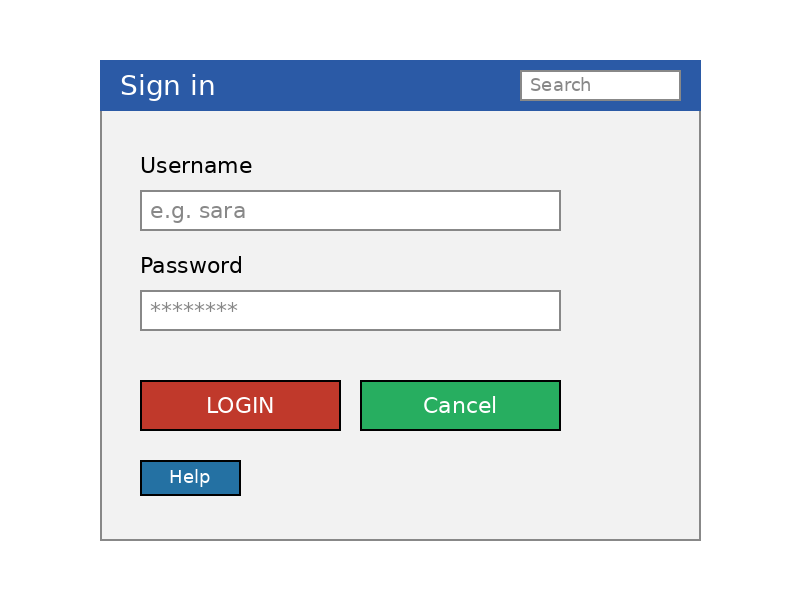

Expected: red LOGIN, green Cancel, blue Help; white search and username fields; button count = 3. Verify all five normalized boxes, labels, and colors.

**Status:** PENDING — no independent visual evidence recorded.

### 2. Noisy UI login — `ui_login_noisy.png`

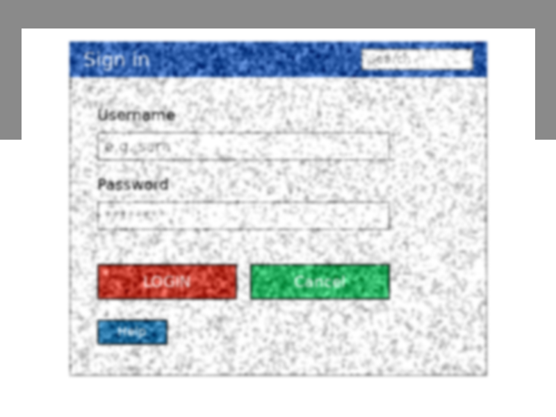

Expected: same targets, boxes, colors, and button count as `ui_login.png`. Verify noise/blur and side/corner occlusion do not change or obscure target identity.

**Status:** PENDING — no independent visual evidence recorded.

### 3. UI toolbar — `ui_toolbar.png`

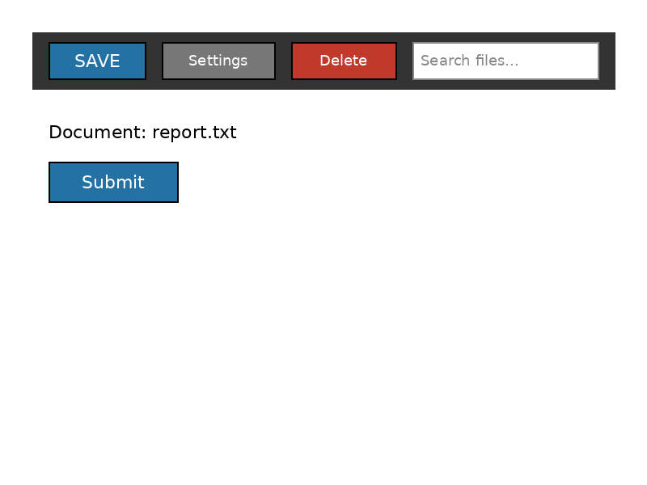

Expected: blue SAVE, gray Settings, red Delete, white toolbar search field; button count = 3. Verify all four normalized boxes, labels, and colors.

**Status:** PENDING — no independent visual evidence recorded.

### 4. Perturbed UI toolbar — `ui_toolbar_perturbed.png`

Expected: same toolbar targets and count as `ui_toolbar.png`. Verify the stated redraw/shift and seeded speckle preserve target identity and remain compatible with the oracle's tolerance.

**Status:** PENDING — no independent visual evidence recorded.

### 5. Arabic card — `arabic_card.png`

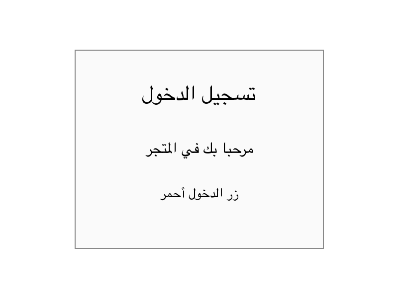

Expected lines: “تسجيل الدخول”, “مرحبا بك في المتجر”, “زر الدخول أحمر”. Verify the six listed keywords and that the rendered Arabic text/order is legible and consistent with the stored logical order.

**Status:** PENDING — no independent visual evidence recorded.

### 6. Shape count — `grid_count.png`

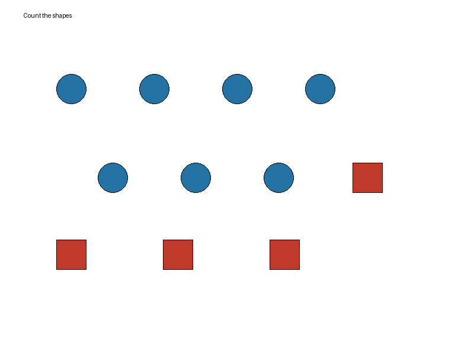

Expected: 7 blue circles, 4 red squares, 11 total shapes. Count each target once and check no non-target object matches the target definitions.

**Status:** PENDING — no independent visual evidence recorded.

### 7. Perturbed shape count — `grid_count_perturbed.png`

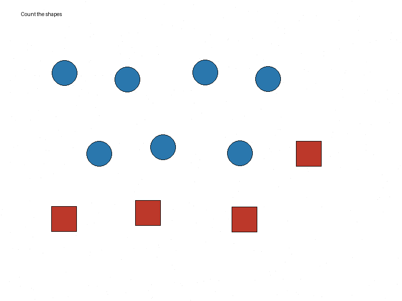

Expected: same counts as `grid_count.png` despite seeded speckle, 5–10px shifts, and slight color variation. Verify speckles do not resemble target shapes.

**Status:** PENDING — no independent visual evidence recorded.

### 8. Dense shape count — `grid_dense.png`

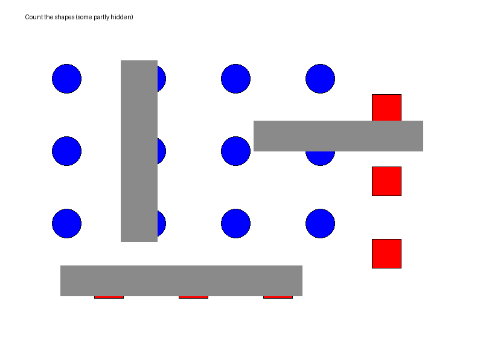

Expected: 12 blue circles, 6 red squares, 18 total. Three gray bars are occluders; partially visible target shapes still count.

**Status:** PENDING — no independent visual evidence recorded.

### 9. Spatial relation — `spatial.png`

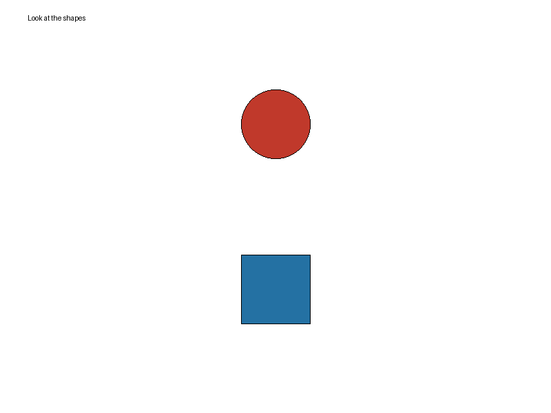

Expected: red circle above blue square; stored centers are (400,180) and (400,420), respectively. Verify geometry and Arabic relation target “فوق”.

**Status:** PENDING — no independent visual evidence recorded.

### 10. Chart reading — `chart.png`

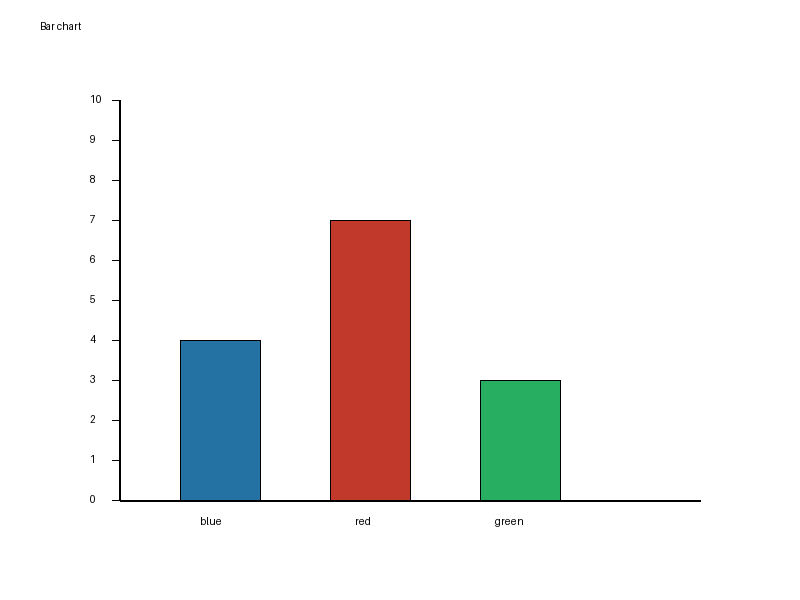

Expected bars: blue = 4, red = 7, green = 3; y-axis maximum = 10; target red value = 7. Verify heights against axis ticks; values are not printed on bars.

**Status:** PENDING — no independent visual evidence recorded.

### 11. Orders table — `table_orders.png`

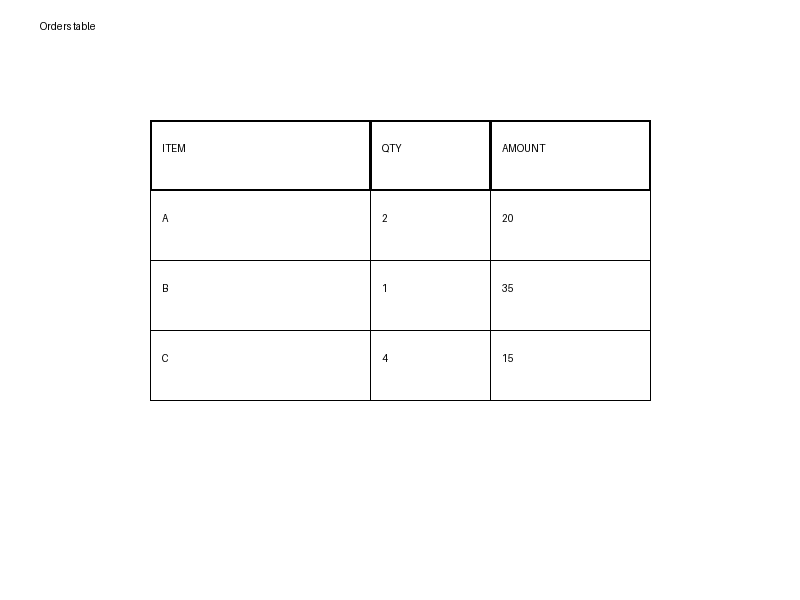

Expected headers ITEM/QTY/AMOUNT and rows A(2,20), B(1,35), C(4,15). Data-row count excludes the header (3); item C's AMOUNT is 15.

**Status:** PENDING — no independent visual evidence recorded.

### 12. V7 image-difference pair — `diff_a.png` and `diff_b.png`

**Image A**

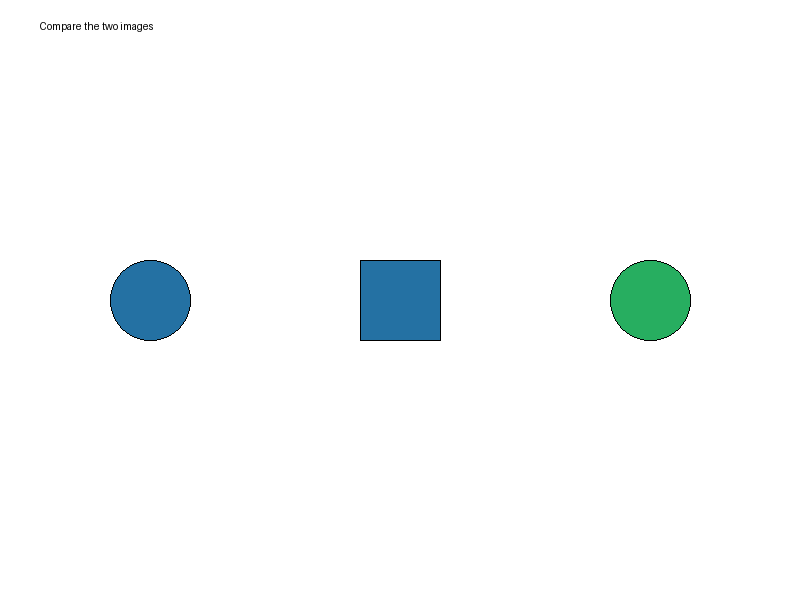

**Image B**

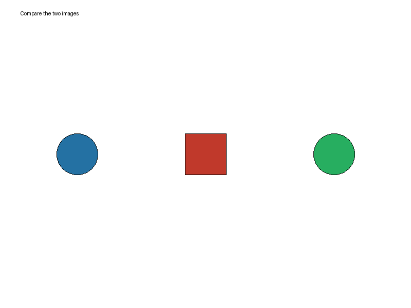

Expected: the only intended difference is the middle square changing color from blue to red. Verify positions and sizes are otherwise unchanged.

**Status:** PENDING — no independent visual evidence recorded.

## Review record

| Field | Value |
|---|---|
| Reviewer | PENDING |
| Review date | PENDING |
| Display scale / method | PENDING |
| Fixtures visually PASS | 0 / 12 |
| Correction needed | PENDING |
| Unresolved | 12 / 12 |

## Interpretation and acceptance

- This matrix is a review aid, not proof that annotations are correct.
- Mark a fixture **PASS** only after visual comparison and a concise evidence note.
- Mark **CORRECTION NEEDED** when the pixels conflict with the annotation; mark **UNRESOLVED** when the image is ambiguous or cannot be inspected adequately.
- Keep historical result bundles and frozen evidence untouched. Any approved correction must be a separate reviewed change and must update the relevant hash/provenance.
- After an approved correction, rerun deterministic Vision fixture-integrity and test groups.
- Real-model/provider trials are outside this review.
